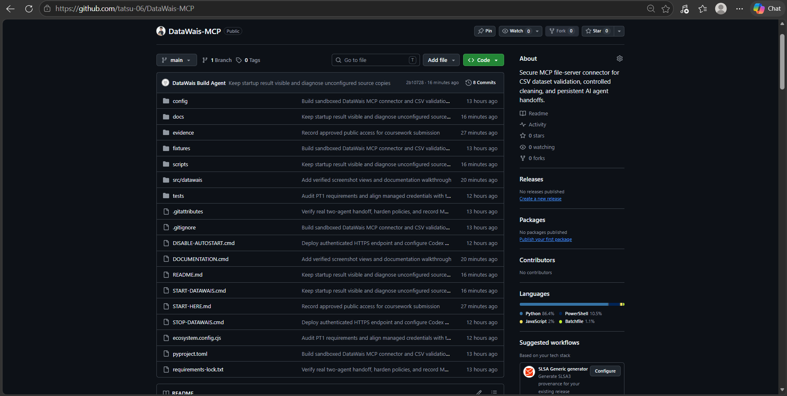
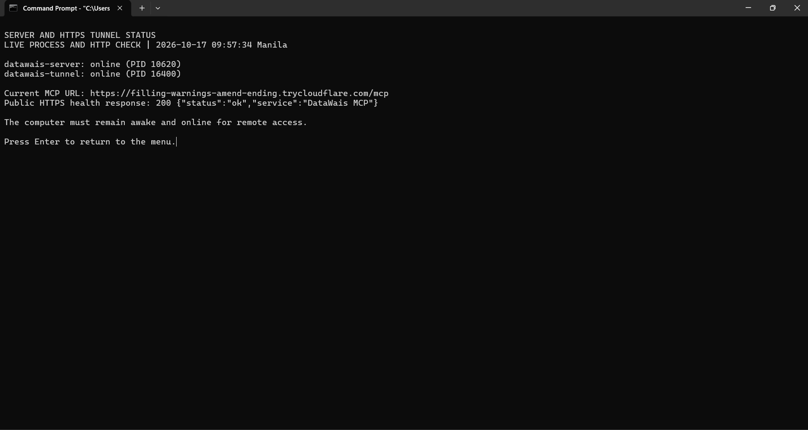
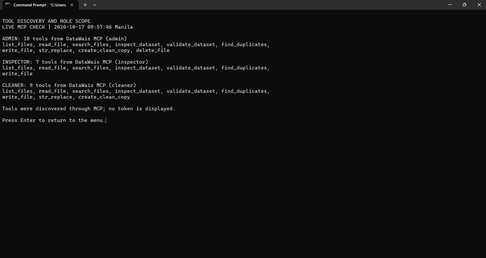
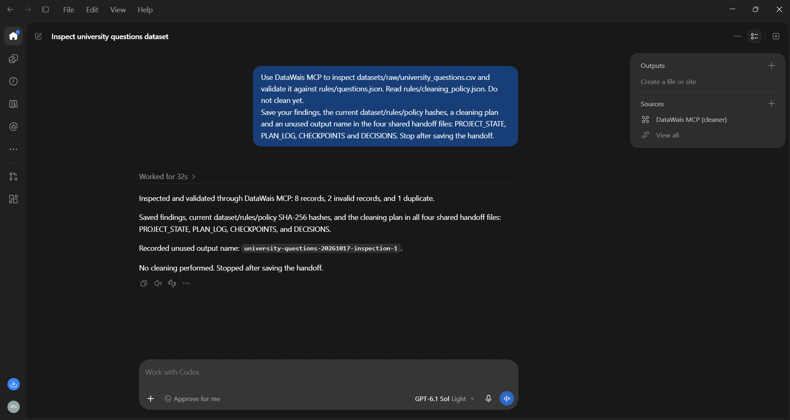
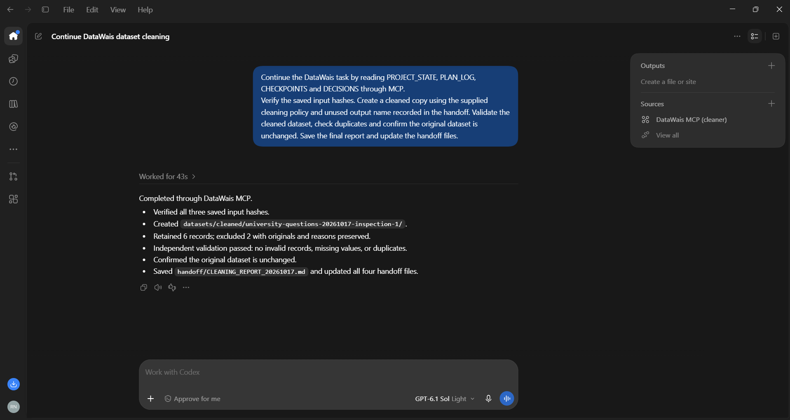
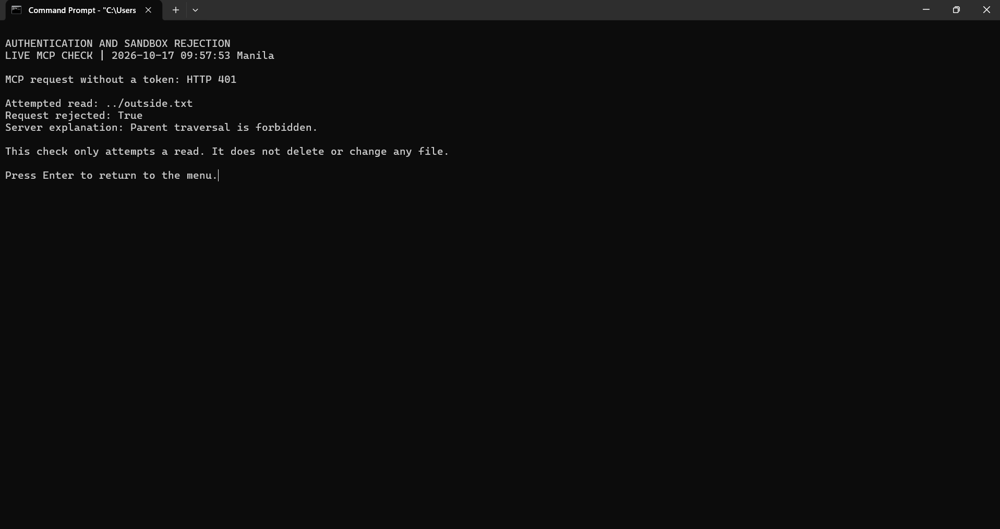
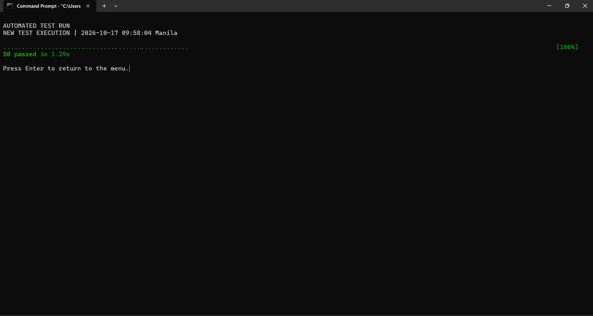

# DataWais MCP Project Documentation

PT1 implementation and demonstration report

Demonstration date 17 October 2026 | Time zone Asia Manila

GitHub account tatsu-06

[Public repository  github.com/tatsu-06/DataWais-MCP](https://github.com/tatsu-06/DataWais-MCP)

DataWais is an MCP file-server connector for checking and preparing CSV datasets. It exposes controlled filesystem and dataset tools to an AI client, preserves the original data, and saves progress so a fresh agent session can continue a multi-step task.

The demonstrated workflow inspected eight synthetic university question records, saved a handoff, and continued in a separate conversation. Cleaning retained six valid records and excluded two records with their original values and reasons preserved. The raw dataset hash remained unchanged. The supplied test screenshot records 50 passing tests.

### Problem and objectives

Dataset preparation can introduce errors when missing values, duplicate examples and inconsistent labels are corrected manually. Work can also lose context when an AI conversation ends. DataWais addresses these problems with explicit validation rules, a supplied cleaning policy and persistent handoff files.

The objectives are to provide a sandboxed MCP file server, expose useful dataset tools, deploy an authenticated HTTPS endpoint under a process manager, and demonstrate continuation across more than one agent session.

### System architecture

User request → AI host and MCP client → authenticated DataWais server → protected workspace files

The AI client selects tools. The Python server executes deterministic file and CSV operations through the official MCP SDK. Uvicorn serves Streamable HTTP on localhost, PM2 supervises the server and tunnel, and Cloudflare provides the public HTTPS address. No model API is called inside DataWais itself.

### Evidence in this report

Seven distinct screenshots document the repository, deployment, tool discovery, two agent sessions, security checks and automated tests. Figures show focused viewports of the original captures; all eight original images, including the earlier duplicate deployment capture, are retained in the screenshot folder. The new run is named university-questions-20261017-inspection-1.


---

## Repository and PT1 requirements



*Figure 1  The public DataWais MCP repository contains source code, configuration, tests, documentation and execution evidence. The image records the repository at capture time.*

| Requirement | Implemented evidence |
| --- | --- |
| MCP file-server connector | Python MCP SDK and Streamable HTTP; ten tools in the admin scope. |
| Sandboxed filesystem | Workspace boundary checks, protected originals and controlled output locations. |
| HTTPS deployment and supervision | Cloudflare tunnel and DataWais server supervised by PM2. |
| Persistent task management | PROJECT_STATE, PLAN_LOG, CHECKPOINTS and DECISIONS. |
| More than one agent session | Separate inspection and continuation chats, supported by a tool-call index and saved outputs. |
| Documentation and validation | This report, repository README, security checks and 50 passing tests. |

The repository provides the implementation and supporting evidence for review. The course live presentation is a separate assessed activity. The sample dataset is synthetic and is not a collection of private student records.


---

## Deployment and startup

The deployment capture at 09:57:34 Manila shows both managed processes online and a successful public HTTPS health response.



*Figure 2  datawais-server and datawais-tunnel are online. The public health endpoint returns HTTP 200 with service DataWais MCP.*

### Running the configured installation

On the configured Windows computer, open Command Prompt and run the saved launcher as one command.

```text
"C:\Users\ryuna\Documents\DataWais\START-DATAWAIS.cmd"
```

Wait for STARTUP COMPLETE. PM2 continues running the services after the launcher window closes. The current installation and its private supporting runtime files are in Documents\DataWais. Sign-in startup and the local AI client connection point to this folder.

For terminal diagnostics, run the following launcher and select the required check.

```text
"C:\Users\ryuna\Documents\DataWais\DOCUMENTATION.cmd"
```

The diagnostics client makes actual MCP and HTTP requests. The health endpoint confirms reachability; authenticated MCP access is checked separately. The quick-tunnel address is temporary and can change after restart. The computer must remain awake and online for remote access.

### Installed components

| Component | Purpose |
| --- | --- |
| Python and MCP SDK | Implement the file-server tools and MCP protocol. |
| Uvicorn | Serve the local HTTP application. |
| PM2 | Supervise the server and tunnel processes. |
| Cloudflare tunnel | Expose the local service through HTTPS. |
| Connected AI client | Choose and call tools in response to the user task. |


---

## MCP tools and role permissions



*Figure 3  Live MCP discovery returns ten admin tools, seven inspector tools and nine cleaner tools. The server controls each role scope.*

| Tool | Function |
| --- | --- |
| list_files | List files within the protected workspace. |
| read_file | Read bounded file content and obtain its hash. |
| search_files | Search permitted workspace text. |
| inspect_dataset | Inspect CSV columns, records and missing values. |
| validate_dataset | Check supplied dataset rules and duplicates. |
| find_duplicates | Find repeated records using selected keys. |
| write_file | Write permitted text and handoff files. |
| str_replace | Replace exact text using a current hash guard. |
| create_clean_copy | Apply a supplied policy to a new output run. |
| delete_file | Delete eligible files with admin scope and guards. |

The inspector has the six reading and dataset tools plus write_file. The cleaner adds str_replace and create_clean_copy. Only admin has delete_file. Both new agent conversations shown in this report used the configured cleaner connection; inspection and cleaning describe their task stages.


---

## First session inspection and handoff

In the fresh chat titled Inspect university questions dataset, the user requested inspection and planning only. The session read the source CSV, validation rules, cleaning policy and existing shared state through DataWais MCP.



*Figure 4  The first session reports eight records, two invalid records and one duplicate, then saves the findings and plan in the four handoff files without cleaning.*

Validation identified an invalid paymnt label and one missing question. The duplicate repeated an earlier question and label. The policy supplied the only allowed label mapping, paymnt to payment, and required trimming and duplicate removal.

The session recorded all three input SHA-256 hashes and selected the unused output name university-questions-20261017-inspection-1. It saved the findings, plan, checkpoints and decisions for the next session.

The chat record contains 17 MCP tool calls. An inspect_dataset request with sample_rows=10 was rejected because the allowed maximum is five; the session retried with sample_rows=5 and completed the handoff. The failed call remains in the evidence index.


---

## Second session continuation and cleaning

In the separate chat titled Continue DataWais dataset cleaning, the user requested continuation from the shared files. Its tool record begins with reads of the handoff and inputs before the cleaning call.



*Figure 5  The continuation session verifies the saved hashes, creates a new cleaned run, validates the result and updates the four handoff files.*

After checking the source, rules and policy hashes and confirming that the output name was unused, create_clean_copy created cleaned.csv, excluded.json and report.json together. Separate validation and duplicate checks confirmed the cleaned result. The final report was saved as handoff/CLEANING_REPORT_20261017.md.

The chat record contains 25 MCP tool calls. A request for six sample rows exceeded the five-row limit and was retried successfully with five. Both handled failures are preserved in the supporting index.

The four shared files provide persistent task memory: PROJECT_STATE records current status and paths; PLAN_LOG records the plan and execution; CHECKPOINTS records verified milestones; DECISIONS records policy choices and constraints. The second session could continue from these files instead of requiring the first conversation to be pasted into it.


---

## Dataset results and source preservation

The generated report and saved files confirm the result of the new run. Record counts refer to logical CSV records and exclude the header.

| Measure | Original | Cleaned |
| --- | --- | --- |
| Records | 8 | 6 |
| Invalid records | 2 | 0 |
| Duplicate records | 1 | 0 |
| Missing question values | 1 | 0 |
| Validation result | Failed | Passed |

Two invalid records and one duplicate are separate findings; they do not mean three exclusions. The invalid label was repaired under the explicit policy. The missing question and duplicate were excluded, leaving six records.

| Source record | Recorded action |
| --- | --- |
| 3 | Excluded as a duplicate of record 1; original values retained in excluded.json. |
| 4 | Mapped label paymnt to payment using the supplied policy. |
| 5 | Excluded for validation:question:missing_value; original values retained. |
| 6 | Trimmed surrounding question whitespace. |

### Output files

Run folder  datasets/cleaned/university-questions-20261017-inspection-1

cleaned.csv contains the six retained records. excluded.json contains both excluded originals and reasons. report.json contains counts, input hashes and validation results. Quoted commas and embedded newlines remain preserved in the CSV.

### Verified SHA 256 values

Original dataset before and after cleaning

```text
9494e4d2774094d4f3480c958a308487ed62e2ba941b5dff1cd9629248febef7
```

Cleaned dataset

```text
c26b3020b271c1587967e24499436990cc076d655f669b95cdb65ad98a6191de
```

The original hash matches the source hash recorded at cleaning time. The current cleaned file hash matches the generated report. These checks establish byte preservation and output identity for this run.


---

## Security checks and automated tests



*Figure 6  An MCP request without a token returns HTTP 401. An attempted read of ../outside.txt is rejected because parent traversal is forbidden.*

Authentication restricts MCP access to configured credentials. Workspace path checks reject attempts to escape the root. Raw datasets and operator-supplied rules are protected from agent modification. Cleaning requires current source, rule and policy hashes and writes a separate output run.



*Figure 7  The supplied automated test screenshot records 50 passed in 1.29 seconds at 09:58:04 Manila on 17 October 2026.*

The tests cover filesystem restrictions, role access, hash guards, CSV handling, cleaning outputs, token handling and tunnel hostname configuration. The terminal tests and security checks supplement the actual two-session workflow; they are scripted checks rather than AI agent sessions.

Passing validation establishes compliance with the supplied rules. It does not establish that every question is factually correct, unbiased or suitable for model training. The implementation assumes a trusted local machine owner and a single writer process.


---

## Reproduction and evidence index

On the configured computer, start DataWais, enable its MCP connection in an AI client, and open a fresh conversation. Ask the first session to inspect the raw dataset, read both supplied configurations and save the four handoff files without cleaning. Use a fresh second conversation to read that handoff, verify hashes, create an unused output run and validate its results.

Use a new output name for each run. The demonstrated folder already exists. Source clones on another computer require the installation steps in README.md and new private credentials; the launcher alone does not provision a downloaded clone.

### Repository evidence

[Screenshot originals and image manifest](https://github.com/tatsu-06/DataWais-MCP/tree/main/docs/screenshots/2026-10-17)

[Tool-call index and completed workspace snapshot](https://github.com/tatsu-06/DataWais-MCP/tree/main/evidence/2026-10-17-user-demo)

[Full earlier protocol transcripts and technical checks](https://github.com/tatsu-06/DataWais-MCP/tree/main/evidence)

[Source code and test suite](https://github.com/tatsu-06/DataWais-MCP/tree/main/src/datawais)

The new session index is extracted from the actual application chat records. It records tool names, arguments other than written content, statuses and timings. It is an execution index, not a raw protocol-response transcript. The earlier 16 October run retains its separate full JSONL transcripts and is not relabeled as the new screenshot run.

### Operational limits

Remote access depends on the host computer and the quick tunnel. The endpoint may change after restart. CSV processing is bounded to 5 MiB, 10,000 rows and 100 columns. An inspection returns at most five sample rows. Cleaning applies the supplied policy rather than inferring corrections, and a passed rules check does not measure broader dataset quality.

### Conclusion

DataWais demonstrates a working MCP file-server connector with controlled dataset operations and persistent continuation. The two separate agent sessions completed inspection, handoff, policy-based cleaning and verification. Deployment, tool discovery, authentication, path rejection and the automated suite provide additional execution evidence. The final output contains six valid records, with two exclusions documented and the original source preserved.

### Course reference

MCP Week6 Presentation2, PT1 project brief, supplied course handout. The brief requires an MCP file-server connector, deployment and a real multi-step task across more than one agent session.
